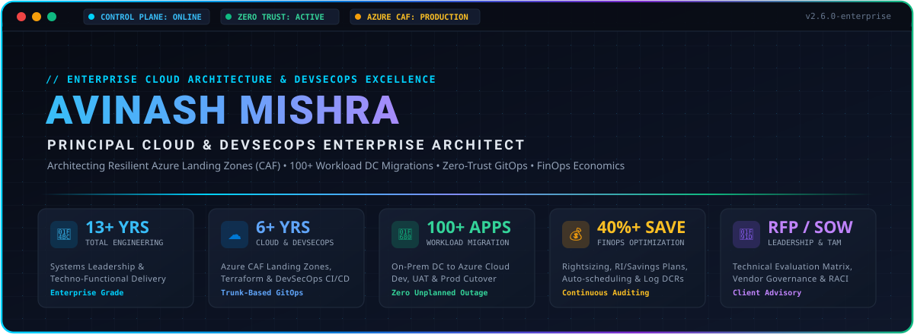

<div align="center">

  <!-- Custom High-Tech Vector SVG Hero Banner -->
  

  <br/>

  <!-- User's Signature High-Contrast Dual-Tone Skill & Profile Badges -->
  <p align="center">
    
    &nbsp;
    
  </p>

  <p align="center">
    
    &nbsp;
    
  </p>

  <p align="center">
    
    &nbsp;
    
    &nbsp;
    
  </p>

  <!-- Interactive Action & Engagement Badges -->
  <p align="center">
    <a href="https://linkedin.com/in/avinashkean">
      
    </a>
    &nbsp;
    <a href="mailto:avinashkean@gmail.com">
      
    </a>
    &nbsp;
    <a href="mailto:avinashkean@gmail.com?subject=Schedule%20Architecture%20Review">
      
    </a>
    &nbsp;
    <a href="./blueprints/02-100-workload-cloud-migration-playbook.md">
      
    </a>
  </p>

  <!-- Dynamic Typing Subtitle -->
  <p align="center">
    <a href="https://readme-typing-svg.demolab.com">
      
    </a>
  </p>

</div>

---

## 🏛️ Executive Summary & Value Proposition

> *"True enterprise architecture is not merely deploying cloud services; it is designing resilient, self-healing, cost-governed ecosystems that empower businesses to innovate at velocity without compromising security or fiscal sanity."*

With **13+ years of overall engineering excellence** and **6+ years deeply specialized in Enterprise Cloud & DevSecOps**, I bridge high-level corporate strategy with ground-level technical mastery. My career spans the complete techno-functional spectrum—from hands-on infrastructure engineering to enterprise-wide Cloud Adoption Framework (CAF) governance, multi-datacenter migrations, and multi-million-dollar PreSales/SOW ownership.

### 🌟 Career Spectrum & Techno-Functional Continuum

| Domain Role | Strategic & Operational Focus |
| :--- | :--- |
| **🚀 Enterprise Architect** | Multi-tenant Management Group design, CAF landing zone blueprints, cross-platform system integration, Zero-Trust network topologies, and high-level enterprise cloud roadmaps. |
| **⚙️ Technical Lead** | Modular Terraform engineering, Azure DevSecOps CI/CD templates, trunk-based GitOps governance, drift detection pipelines, and hands-on system troubleshooting. |
| **🤝 Technical Account Manager (TAM)** | Client engagement, service ownership, SLA governance, escalation management, incident post-mortems, and customer cloud adoption maturity. |
| **💼 PreSales & Solutions Leader** | Technical task scoping, RFP/RFI responses, SOW crafting, vendor technical evaluation matrices, commercial proposals, and cost-benefit ROI analysis. |

---

## 📊 Executive Impact Metrics at a Glance

```
┌────────────────────────────────────────────────────────────────────────────────────────┐
│                               ENTERPRISE TRACK RECORD                                  │
├──────────────────────────┬──────────────────────────┬──────────────────────────────────┤
│        13+ YEARS         │         6+ YEARS         │            100+ APPS             │
│    Total Engineering     │  Enterprise Cloud/DevOps │      Migrated to Azure Cloud     │
│   Leadership & Systems   │   (Azure, IaC, GitOps)   │   (Dev / UAT / Prod Workloads)   │
├──────────────────────────┼──────────────────────────┼──────────────────────────────────┤
│        ZERO-TRUST        │         40%+ SAVE        │              99.99%              │
│  Hub-and-Spoke Security  │    FinOps Cloud Spend    │       Target Availability        │
│ Central Egress / Policy  │  Optimization Delivered  │     Multi-Region BCDR & VMSS     │
└──────────────────────────┴──────────────────────────┴──────────────────────────────────┘
```

---

## 📚 Enterprise Architecture Blueprints & Production Code Catalog

This repository is designed as an **Enterprise Cloud Architecture Center of Excellence (CCoE)**. Explore the production-ready code repositories, blueprints, and automation toolchains below:

### 🚀 Production Code Repositories & Modules

| Domain | Architecture Path | Key Technologies & Implemented Capabilities |
| :--- | :--- | :--- |
| **🏛️ Enterprise Terraform** | **[`terraform/`](./terraform)** | Modular Azure CAF Landing Zones: Hub-and-Spoke VNet, Azure Firewall Premium (IDPS), Custom Policy Initiatives, Hardened Key Vault with Private Endpoints, and Private AKS Cluster with Workload Identity. |
| **💰 FinOps Cloud Economics** | **[`finops/`](./finops)** | Orphaned managed disk purge runbooks, idle public IP scanners, Infracost automated PR cost breakdown, and Azure Budget variance policies. |
| **🤖 AIOps Observability** | **[`aiops/`](./aiops)** | KQL ML time-series anomaly detection, Python statistical Z-score telemetry analyzer, and automated self-healing restart runbooks. |
| **🧠 MLOps Lifecycle** | **[`mlops/`](./mlops)** | Azure ML Workspace v2 IaC, auto-scaling 0-node compute cluster, and automated CI/CD pipeline for model registry & blue-green canary deployment. |

---

### 📑 Strategic Architecture Blueprints & Playbooks

| # | Architecture Blueprint & Artifact | Strategic Focus |
| :-: | :--- | :--- |
| **01** | [🏛️ Azure Enterprise Landing Zone (CAF)](./blueprints/01-azure-enterprise-landing-zone-caf.md) | Tenant root hierarchy, Management Groups, Hub & Spoke VNet, Azure Firewall, UDRs, and Azure Policy initiatives. |
| **02** | [🚀 100+ Workload Cloud Migration Playbook](./blueprints/02-100-workload-cloud-migration-playbook.md) | 6-Phase DC-to-Cloud migration lifecycle, 6-R assessment, cutover maintenance windows, and 24/7 hypercare. |
| **03** | [💰 FinOps & Cloud Economics Engineering](./blueprints/03-finops-cloud-cost-optimization-framework.md) | Compute rightsizing, unattached disk purge, non-prod auto-schedules, and Reserved Instances (RI) modeling. |
| **04** | [🛡️ DevSecOps Pipeline & GitOps Architecture](./blueprints/04-enterprise-devsecops-pipeline-architecture.md) | Trunk-based GitOps, branch policies, PR security gates (tfsec, checkov, infracost), and drift detection. |
| **05** | [🌐 BCDR & High Availability Strategy](./blueprints/05-bcdr-and-high-availability-strategy.md) | Storage redundancy (LRS, ZRS, GRS), VMSS across Availability Zones, RTO < 1h, RPO < 15m, and ASR drills. |
| **06** | [🤝 Vendor Governance & PreSales Matrix](./blueprints/06-vendor-governance-and-presales-matrix.md) | RFP/RFI responses, Technical Evaluation Matrices, SOW formulation, RACI governance, and milestone releases. |

### ⚙️ Production Automation Tooling
- ⚡ **[Orphaned Disk FinOps Audit Script](./finops/scripts/cleanup-orphaned-disks.ps1)** — PowerShell tool to scan and audit unattached disks & idle public IPs.
- ⚡ **[Non-Prod VM Auto-Scheduler](./finops/scripts/auto-start-stop-vms.ps1)** — Automated runbook for scheduled VM stop/start, reducing non-prod compute spend by up to 70%.
- ⚡ **[Unattached Public IP Audit Tool](./finops/scripts/unattached-public-ip-audit.ps1)** — Scans for unattached IPs and calculates projected annual savings.
- ⚡ **[AIOps Telemetry Incident Analyzer](./aiops/detectors/telemetry-incident-analyzer.py)** — Python Z-score anomaly detector and self-healing trigger.
- ⚡ **[Terraform Drift Detection Pipeline](./scripts/governance/terraform-drift-detector.ps1)** — Automated CI/CD script to identify unauthorized portal modifications.

---

## 🏗️ Enterprise Architecture Blueprint

Below is the architectural blueprint illustrating my standard **Enterprise Azure Cloud Adoption Framework (CAF) Landing Zone & DevSecOps Delivery Engine**:

```mermaid
flowchart TB
    %% Styling
    classDef root fill:#1e1e2e,stroke:#89b4fa,stroke-width:2px,color:#cdd6f4;
    classDef mg fill:#181825,stroke:#b4befe,stroke-width:1.5px,color:#cdd6f4;
    classDef sub fill:#11111b,stroke:#a6adc8,stroke-width:1px,color:#bac2de;
    classDef net fill:#0f172a,stroke:#38bdf8,stroke-width:2px,color:#e0f2fe;
    classDef devops fill:#064e3b,stroke:#34d399,stroke-width:2px,color:#ecfdf5;
    classDef sec fill:#450a0a,stroke:#f87171,stroke-width:1.5px,color:#fef2f2;

    subgraph MG_Hierarchy ["🏛️ Tenant & Management Group Hierarchy (Azure Entra ID)"]
        TR["Tenant Root Group (Tenant Policies & Global Guardrails)"]:::root
        
        PLAT_MG["Platform Management Group"]:::mg
        LZ_MG["Landing Zones Management Group"]:::mg
        SAND_MG["Sandbox & Decommissioned MGs"]:::mg
        
        TR --> PLAT_MG
        TR --> LZ_MG
        TR --> SAND_MG

        SUB_CONN["Connectivity Subscription<br/>(Hub VNet, ExpressRoute, Azure FW)"]:::sub
        SUB_MGMT["Management Subscription<br/>(Log Analytics, Azure Monitor, Sentinel)"]:::sub
        SUB_IDEN["Identity Subscription<br/>(Entra Domain Services, Key Vault)"]:::sub
        
        PLAT_MG --> SUB_CONN
        PLAT_MG --> SUB_MGMT
        PLAT_MG --> SUB_IDEN

        SUB_PROD["Production Subscriptions<br/>(PCI/Corp Workloads, Private AKS)"]:::sub
        SUB_NONPROD["Non-Prod Subscriptions<br/>(Dev, Test, UAT Workloads)"]:::sub
        
        LZ_MG --> SUB_PROD
        LZ_MG --> SUB_NONPROD
    end

    subgraph Network_Topology ["🌐 Secure Hub & Spoke Networking (Zero-Trust)"]
        HUB_VNET["HUB VNet (Central Inspection)<br/>• Azure Firewall Premium (IDPS/TLS)<br/>• ExpressRoute & VPN Gateway<br/>• Central Private DNS Zones<br/>• Azure Bastion Host"]:::net
        
        SPOKE_PROD["Spoke VNet: Production Workloads<br/>• Private Endpoints (SQL / Storage)<br/>• UDR Force-Tunnel to Hub FW<br/>• Microsegmentation NSGs"]:::net
        
        SPOKE_DEV["Spoke VNet: Dev / UAT Workloads<br/>• Isolated Subnets<br/>• Auto-shutdown Compute<br/>• Restricted Peering Egress"]:::net
        
        HUB_VNET <== "Bi-directional VNet Peering" ==> SPOKE_PROD
        HUB_VNET <== "Bi-directional VNet Peering" ==> SPOKE_DEV
    end

    subgraph DevSecOps_Pipeline ["🚀 Enterprise DevSecOps & Governance Delivery"]
        REPO["Azure Repos / GitHub<br/>(Trunk-Based, Branch Policies, PR Gating)"]:::devops
        TF["Terraform Enterprise IaC<br/>(Remote State, CMK, Reusable Modules)"]:::devops
        GATE["Quality & Security Gates<br/>(tflint, tfsec, checkov, infracost)"]:::sec
        DRIFT["Automated Pipelines<br/>(Scheduled Drift Detection & Apply)"]:::devops

        REPO --> TF --> GATE --> DRIFT
    end

    SUB_CONN -. "Governs" .-> HUB_VNET
    SUB_PROD -. "Hosts" .-> SPOKE_PROD
    SUB_NONPROD -. "Hosts" .-> SPOKE_DEV
    DevSecOps_Pipeline ==> "Automates & Audits" ==> TR
```

---

## 🎯 7 Core Engineering & Leadership Pillars

<details open>
<summary><b>1️⃣ Enterprise Cloud Architecture & Azure Landing Zones (CAF)</b></summary>
<br/>

- **Tenant & Management Group Architecture:** Designed scalable hierarchical structures adhering to Microsoft Cloud Adoption Framework (CAF): Tenant Root Group branching into **Platform** (Connectivity, Management, Identity), **Landing Zones** (Corp, Online, Confidential), **Sandbox**, and **Decommissioned**.
- **Subscription Vending & Lifecycle:** Automated subscription onboarding/offboarding workflows, blueprinting subscription boundaries to enforce isolation across Dev, UAT, and Production.
- **Enterprise Governance & Policy Enforcement:** Architected and assigned custom Azure Policies and Initiative Definitions (auditing/enforcing mandatory resource tags, geo-fencing deployments, denying public IP allocations on NICs, requiring encryption-in-transit, enforcing TLS 1.3).
- **Policy Exemption Framework:** Established rigorous exemption mechanisms with documented business justification, risk assessment, expiring validity, and compliance reporting.
- **Identity & RBAC:** Enforced Least-Privileged Access (PoLP) via custom RBAC roles, Azure AD / Microsoft Entra ID Privileged Identity Management (PIM) with just-in-time approval flows, and Conditional Access policies.

</details>

<details>
<summary><b>2️⃣ Hub-and-Spoke Networking & Zero-Trust Defense</b></summary>
<br/>

- **IPAM & Non-Overlapping CIDR Strategy:** Carried out end-to-end on-premises datacenter CIDR assessments to engineer conflict-free subnet allocations across multi-region Azure virtual networks.
- **Centralized Inspection Hub:** Deployed Hub VNets equipped with Azure Firewall Premium (IDPS, URL filtering, TLS inspection) to enforce centralized inspection and controlled outbound internet egress.
- **User-Defined Routing (UDR):** Architected custom route tables across all spoke subnets to force-tunnel `0.0.0.0/0` traffic and spoke-to-spoke lateral traffic through the central firewall cluster.
- **Private Endpoints & DNS Zones:** Replaced public PaaS endpoints with Azure Private Endpoints for Azure SQL, Blob Storage, Key Vault, and Web Apps, integrated with centralized Private DNS Zones and virtual network links.
- **Hybrid Cloud Connectivity:** Designed redundant ExpressRoute circuits with active-passive VPN Gateway failover to guarantee 99.99% hybrid connectivity uptime.
- **4-Tier Security Defense:**
  - *Identity Level:* Entra ID PIM, MFA, Conditional Access, Managed Identities (no credentials in code).
  - *Networking Level:* Micro-segmentation with NSGs/ASGs, Azure Firewall, DDoS Network Protection.
  - *Governance Level:* Azure Policy guardrails, CIS Benchmarks, Microsoft Defender for Cloud scorecards.
  - *Compute Level:* Just-In-Time (JIT) VM access, automated OS patching, vulnerability assessment.

</details>

<details>
<summary><b>3️⃣ Infrastructure as Code (IaC) & DevSecOps Pipelines</b></summary>
<br/>

- **Terraform Enterprise Standards:**
  - Remote state management stored in geo-redundant storage accounts, lease-based blob state locking, and Customer-Managed Key (CMK) encryption.
  - Strict Principle of Least Privilege (PoLP) access to state storage to safeguard sensitive resource properties.
  - Reusable, version-pinned, modular architecture adhering to DRY (Don't Repeat Yourself) design.
  - Continuous **Drift Detection** pipelines scheduled daily to identify unauthorized out-of-band manual cloud modifications.
- **Enterprise Azure DevOps & GitOps Pipelines:**
  - Standardized enterprise YAML pipeline templates encompassing: `Validate`, `Lint`, `Build`, `Security Scan`, `Plan`, `Manual Gate Approval`, `Apply`, and `Automated Rollback`.
  - Quality and security gates integrated into pull requests: `tflint`, `terraform fmt`, `checkov`, `tfsec`, and secret scanning (`git-secrets`, `trufflehog`).
  - Pre-deployment financial impact preview using `infracost` directly commented on PRs.
- **Branching & Release Governance:**
  - Trunk-based branching model with short-lived feature branches.
  - Enforced branch policies on `main`: Branch deletion prohibited, minimum 2 peer code reviews mandatory, CODEOWNERS approval required, and zero-failing CI build validation.
  - Automated VM configuration and middleware bootstrap leveraging cloud-init and custom script extensions.

</details>

<details>
<summary><b>4️⃣ 100+ Enterprise Workload Cloud Migration Framework</b></summary>
<br/>

Led end-to-end cloud migrations of **100+ multi-tier enterprise workloads** across Dev, UAT, and Production from legacy on-premises datacenters to Azure, delivering **Scalability, Resilience, High Availability, and Zero Unplanned Downtime**.

```
[ Phase 1: Discovery ] ──> [ Phase 2: Assessment ] ──> [ Phase 3: Pre-Checklist ]
  • CMDB Audit                • 6-R Categorization        • Landing Zone Ready
  • Dependency Mapping        • TCO & ROI Forecast        • Network CIDR Reserved
  • Performance Baseline      • Azure Migrate Setup       • Firewall Ports Verified
                                                                   │
                                                                   ▼
[ Phase 6: Decommission ] <── [ Phase 5: Cutover ] <── [ Phase 4: Execution ]
  • Legacy DC Turnoff         • Go-Live Window Sync       • Staging Replication
  • Post-Checklist Signoff    • DNS Switchover            • Test Failovers (UAT)
  • Final FinOps Audit        • 24/7 Hypercare Support    • Delta Sync Execution
```

- **Pre-Migration Checklist:** Complete discovery and inventory audit, dependency visualization, network bandwidth sizing, Azure Landing Zone provisioning, IAM privilege assignment, and target backup verification.
- **During Migration (Cutover Window):** Controlled change window execution, final delta replication sync, automated database schema/data migration, cutover orchestration, and smoke testing.
- **Post-Migration & Hypercare Checklist:** Application performance monitoring baseline comparison, log telemetry validation, automated backup retention verification, SLA validation, and dedicated 2-4 week hypercare stabilization support before legacy infrastructure decommissioning.

</details>

<details>
<summary><b>5️⃣ FinOps & Cloud Economics Engineering</b></summary>
<br/>

- **Cost Visibility & Organizational Tagging:** Enforced comprehensive tagging policies (`CostCenter`, `Environment`, `ApplicationID`, `Owner`, `BusinessUnit`) to deliver 100% cloud cost attribution across business units.
- **Idle & Orphaned Asset Elimination:** Built automated scripts to detect, flag, and safely purge unattached managed disks, obsolete VM snapshots, idle public IP addresses, and orphaned virtual network gateways.
- **Compute Rightsizing & Auto-Scheduling:**
  - Analyzed 30-day CPU, memory, and disk IOPS metrics to downscale oversized VMs without performance degradation.
  - Implemented automated runbook-based start/stop schedules for non-production environments (Dev, Test, UAT), eliminating off-hours compute costs and reducing non-prod spend by up to 65%.
- **Log Ingestion & Observability Cost Reduction:** Refactored Azure Monitor Data Collection Rules (DCRs) to suppress redundant debug and trace logs, reducing Log Analytics daily ingestion costs by 35-50%.
- **Commitment Optimization:** Analyzed historical usage patterns to procure 1-Year and 3-Year Azure Reserved VM Instances (RI) and Azure Savings Plans, driving sustained multi-year ROI.
- **Storage Tiering:** Automated lifecycle policies to tier older snapshots and archives from Hot to Cool and Cold/Archive storage tiers.

</details>

<details>
<summary><b>6️⃣ High Availability, Disaster Recovery (BCDR) & SRE</b></summary>
<br/>

- **Resilience & Storage Redundancy:** Architected storage replication tiers according to data criticality: Locally Redundant Storage (LRS), Zone-Redundant Storage (ZRS) for zero-zone-failure tolerance, and Geo-Redundant Storage (GRS) for regional catastrophe protection.
- **High-Availability Compute:** Deployed Virtual Machine Scale Sets (VMSS) across multiple Azure Availability Zones with automated health probes and horizontal autoscaling rules.
- **BCDR Design & SLA Adherence:**
  - Defined and validated rigorous **RTO (Recovery Time Objective)** and **RPO (Recovery Point Objective)** targets per business criticality tier.
  - Configured Azure Site Recovery (ASR) pairing primary and paired secondary Azure regions, conducting quarterly non-disruptive disaster recovery drill simulations.
- **Full-Stack Observability & SRE Operations:**
  - Centralized Azure Monitor, Log Analytics Workspaces, and Application Insights.
  - Engineered advanced KQL (Kusto Query Language) workbooks for real-time traffic analysis, latency profiling, and security auditing.
  - Configured intelligent Azure Action Groups integrated with PagerDuty and incident response platforms for real-time escalation.

</details>

<details>
<summary><b>7️⃣ Techno-Functional Leadership, PreSales & Vendor Management</b></summary>
<br/>

- **PreSales & Strategic Pursuits:**
  - Spearheaded technical responses for enterprise RFPs (Request for Proposal) and RFIs (Request for Information), authoring cloud architecture designs and technical defense presentations.
  - Built comprehensive **Technical Evaluation Matrices** to benchmark cloud platforms, third-party software, and tooling stacks against customer requirements.
  - Formulated commercial proposals, calculating Cloud TCO, operational expenditure models, and multi-year migration ROI.
- **Vendor Governance & Contract Management:**
  - Authored comprehensive Statements of Work (SOW): Detailed Scope of Work, Milestones, Acceptance Criteria, Deliverables, Technical Dependencies, Risks, and Commercial Terms.
  - Designed multi-tiered Escalation Matrices and enforced Least-Privilege Role-Based Access for vendor teams.
  - Led weekly delivery sprint reviews, retrospective meetings, deliverable sign-offs, and milestone-based payment approvals.
- **Transitions, Knowledge Transfer & Team Mentorship:**
  - Governed smooth operational transitions with standardized documentation handovers, runbooks, and RACI matrices.
  - Formulated team upskilling roadmaps, leading senior-level technical hiring interviews and hands-on Knowledge Transfer (KT) bootcamps to foster high-performing engineering cultures.

</details>

---

## 🛠️ Comprehensive Technology & Tooling Stack

<div align="center">

### Cloud Platforms & Architecture
<p>
  
  
  
  
  
</p>

### Infrastructure as Code & Configuration Management
<p>
  
  
  
  
  
</p>

### CI/CD, DevSecOps & Containerization
<p>
  
  
  
  
  
  
</p>

### Networking, Zero-Trust & Identity
<p>
  
  
  
  
  
  
</p>

### Observability, FinOps & Automation
<p>
  
  
  
  
  
  
  
</p>

### Governance, Delivery & Methodology
<p>
  
  
  
  
  
</p>

</div>

---

## 📈 Live GitHub Telemetry & Activity

<div align="center">

  <table border="0">
    <tr>
      <td width="50%" align="center">
        
      </td>
      <td width="50%" align="center">
        
      </td>
    </tr>
    <tr>
      <td colspan="2" align="center">
        
      </td>
    </tr>
  </table>

</div>

---

## 🤝 Let's Connect & Collaborate

Whether you are exploring enterprise cloud migrations, modernizing legacy infrastructure, architecting secure Cloud Adoption Framework Landing Zones, or seeking executive techno-functional advisory, let's start a conversation.

<div align="center">

  <a href="mailto:avinashkean@gmail.com">
    
  </a>
  &nbsp;
  <a href="https://linkedin.com/in/avinashkean">
    
  </a>
  &nbsp;
  <a href="https://github.com/avinashkean-cpu">
    
  </a>

  <br/><br/>

  <p>
    <b>📍 Open to:</b> Principal Cloud Architect Roles • Enterprise Consulting • Cloud Advisory • Speaking & Mentorship
  </p>

  <br/>

  <sub>Designed with architectural precision & engineering excellence • © 2026 Avinash Mishra</sub>

</div>
